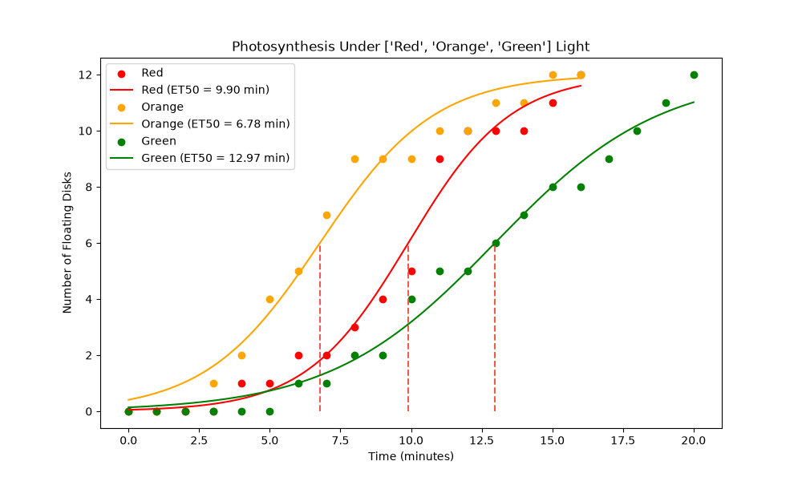
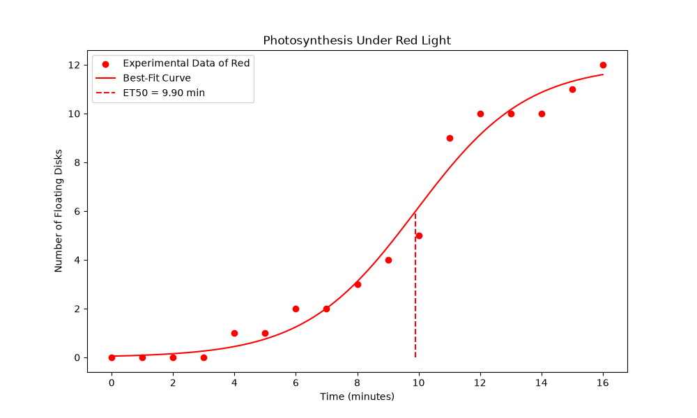

# Photosynthesis Kinetics Modelling Using Python

A computational biology project that uses nonlinear regression to model photosynthetic activity under different wavelengths of light.

## Overview

Photosynthetic pigments absorb different wavelengths of light with varying efficiencies, so light colour affects photosynthetic activity. This project analyses a floating leaf disk assay, where disks rise as photosynthesis produces oxygen, to compare how quickly disks float under different light colours.

Experimental data is fitted to a logistic growth model to:

- estimate the logistic rate parameter $k$ for each light colour
- calculate $t_{50}$, the time for 50% of disks to float (also called ET50)
- compare model performance across light conditions

[Read the full lab report](reports/photosynthesis_lab_report.pdf) for the experimental methodology, observations, and biological interpretation.

## Results


*Fitted logistic curves for each light colour.*


*Observed floating disk counts, fitted curve, and $t_{50}$ marker for red light.*

| Light | k (min⁻¹) | t₅₀ (min) | RMSE (disks) | R² |
|-------|-----------|-----------|--------------|-----|
| Red   | _0.551_    | _9.9_    | _0.595_       | _0.982_ |
| Green  | _0.343_    | _12.97_    | _0.501_       | _0.985_ |
| Blue | _0.274_    | _18.28_    | _0.438_       | _0.988_ |


The table is generated in `photosynthesis_comparison.csv` when the multi-colour analysis runs.

## Mathematical Model

Floating disk counts are fitted to a logistic function:

#### $N(t) = \dfrac{12}{1 + e^{-k(t - t_{50})}}$

where:

- $N(t)$: predicted number of floating leaf disks at time $t$
- $12$: total number of leaf disks in the assay (the upper asymptote)
- $k$: logistic rate parameter (min⁻¹); larger values mean a steeper rise
- $t_{50}$: time at which $N(t) = 6$, i.e. 50% of disks are floating (minutes)

Parameters are estimated with nonlinear least squares using SciPy's `curve_fit()`.

### Model evaluation

Goodness of fit is assessed with two metrics:

$$
\text{RMSE} = \sqrt{\frac{1}{n}\sum_{i=1}^{n}(y_i - \hat{y}_i)^2}
\qquad
R^2 = 1 - \frac{\sum_{i}(y_i - \hat{y}_i)^2}{\sum_{i}(y_i - \bar{y})^2}
$$

- **RMSE** is the average prediction error in floating disks. Lower is better.
- **R²** is the proportion of variation in the observed counts explained by the model. Values closer to 1 indicate a better fit.

## Features

- Import and process experimental data from CSV files with Pandas
- Fit logistic curves and estimate $k$ and $t_{50}$ for each light colour with SciPy
- Evaluate fits with RMSE and R²
- Plot observations alongside fitted curves with Matplotlib, for one colour or several
- Print formatted comparison tables with Tabulate
- Export model results to CSV for further analysis

## Getting Started

### 1. Clone the repository

```bash
git clone https://github.com/<your-username>/photosynthesis-kinetics.git
cd photosynthesis-kinetics
```

### 2. Install dependencies

```bash
python3 -m pip install -r requirements.txt
```

### 3. Prepare the dataset

The input CSV (`observations_estimated.csv`) should follow this format:

```csv
light,time_min,floating_disks
Red,0,0
Red,1,0
Red,2,0
Red,3,0
Red,4,1
```

### 4. Run the analysis

Import the functions in Python or call them from `photosynthesis.py`:

```python
from photosynthesis import get_curve, get_curves

get_curve("Red")                          # fit and plot one light colour
get_curves(["Red", "Blue", "Green"])      # compare several and export results
```

- `get_curve()` fits one light condition, plots it with the $t_{50}$ marker, and reports model statistics.
- `get_curves()` compares multiple conditions, prints a summary table, plots all fitted curves together, and writes `photosynthesis_comparison.csv`.

## Project Structure

```
photosynthesis-kinetics/
├── images/
│   ├── comparison.png
│   └── red_fit.png
├── reports/
│   └── photosynthesis_lab_report.pdf
├── photosynthesis.py
├── observations_estimated.csv
├── photosynthesis_comparison.csv
├── requirements.txt
└── README.md
```

## Technologies

| Tool | Purpose |
|------|---------|
| Python | Primary language |
| Pandas | Data processing and tabular analysis |
| NumPy | Numerical calculations |
| SciPy | Nonlinear regression and parameter estimation |
| Matplotlib | Data visualization |
| Tabulate | Formatted comparison tables |

## Limitations

- The model fixes the maximum at 12 floating disks, matching the assay setup.
- Floating disk counts are an indirect proxy for photosynthetic activity, not a direct measurement of oxygen production.
- The model assumes a sigmoidal response and may not describe every condition equally well.
- R² is not strictly valid for nonlinear regression, and with few time points it can overstate fit quality. Read it alongside RMSE and the plots.
- Confidence intervals are not yet estimated and differences between light conditions are not formally tested.

## Future Work

- Report standard errors for $k$ and $t_{50}$ from the covariance matrix returned by `curve_fit()`
- Add statistical tests for differences between light colours

## Project Goal

This project shows how computational modelling can help interpret biological experiments. Combining experimental measurements with nonlinear regression and quantitative model evaluation makes it possible to identify and compare biological response patterns.

## Author

[GitHub](https://github.com/jinlu-114)
Developed for SBI4U, 2025
